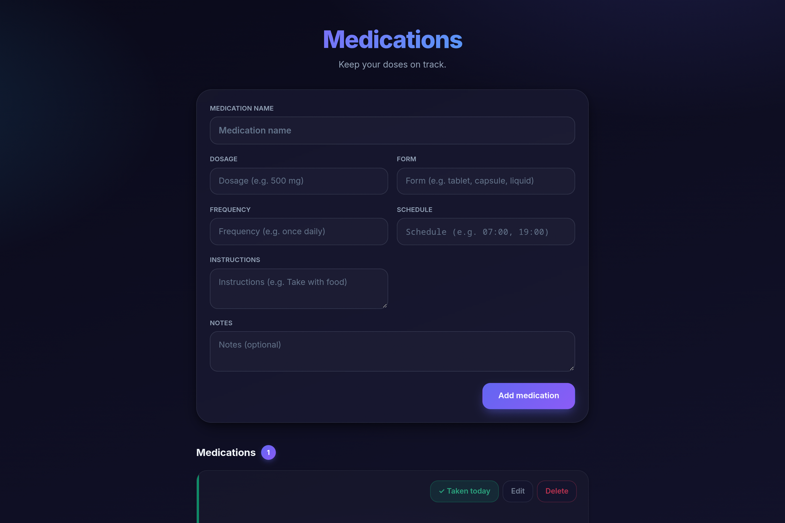

# 💊 Medication Tracker

A modern, lightweight medication tracking application with a sleek React + Vite UI and a fast Hono API. Keep your doses organized with a beautiful, intuitive interface.

[](https://medication-tracker.example.com) <!-- Replace with actual URL if available -->

## ✨ Key Features

- **Modern Design**: Glassmorphism UI with smooth animations and dark mode support
- **CRUD Operations**: Create, read, update, and delete medications with ease
- **Intuitive Interface**: Google Keep-inspired layout with visual medication items
- **Responsive Design**: Works perfectly on desktop, tablet, and mobile devices
- **Type-Safe**: Built with TypeScript for robust development
- **Local Database**: SQLite file persistence (`medications.db`)

## 📱 Screenshot


*The modern, glassmorphic UI with gradient accents and smooth animations.*

## 🚀 Quick Start

### Prerequisites
- Node.js ≥ 22.5 (Node 24+ recommended)
- npm or yarn

### Build the project
```bash
npm run build   # Runs `tsc` → outputs to `dist/`
npm run build:web  # Builds the React UI (outputs to web/dist/)
```

### Run the development server
```bash
npm run dev     # Starts API server (defaults to port 3000)
npm run dev:web # Starts Vite development server (port 5173)
# or
npm start       # Same as `npm run dev`
```

The API will be available at **http://localhost:3000**  
The UI will be available at **http://localhost:3000/ui**

## 🌐 API Endpoints

| Method | Path | Description |
|--------|------|-------------|
| GET | `/` | Simple info endpoint → `{"text":"Medication tracking API running"}` |
| GET | `/medications` | List all medications (array) |
| POST | `/medications` | Create a medication. Body: `{ name?, dosage?, form?, frequency?, schedule?, instructions?, notes? }`. **Name is required.** |
| GET | `/medications/:id` | Get a single medication by ID. Returns 404 if not found or `id` param missing. |
| PATCH | `/medications/:id` | Update `name` and/or optional medication fields. Returns 404 if not found or `id` param missing. |
| DELETE | `/medications/:id` | Delete the medication with the given ID. |

### Example Requests

**Create a medication**
```bash
curl -X POST http://localhost:3000/medications \
  -H "Content-Type: application/json" \
  -d '{"name":"Aspirin","dosage":"500 mg","form":"tablet","frequency":"once daily","schedule":"08:00"}'
```

**List medications**
```bash
curl http://localhost:3000/medications
```

**Get a single medication**
```bash
curl http://localhost:3000/medications/<id>
```

**Update a medication (PATCH)**
```bash
curl -X PATCH http://localhost:3000/medications/<id> \
  -H "Content-Type: application/json" \
  -d '{"name":"Aspirin","dosage":"81 mg"}'
```

**Delete a medication**
```bash
curl -X DELETE http://localhost:3000/medications/<id>
```

## 📂 Project Structure

```
medication-tracker/
├── package.json   # dependencies, scripts (build / build:web / dev / dev:web / start)
├── tsconfig.json  # TypeScript config (strict, outDir ./dist, includes only src/)
├── vite.config.ts # Vite config for the React UI (root: web/, dev proxy /api -> :3000, host 0.0.0.0)
├── Dockerfile    # Docker build/runtime config for the project
├── .dockerignore
├── LICENSE
├── web/           # React + Vite UI (create/edit/delete medications)
│   ├── index.html
│   └── src/
│       ├── main.tsx
│       ├── App.tsx
│       ├── App.css
│       ├── api.ts
│       ├── types.ts
│       └── components/
│           └── MedicationItem.tsx
└── src/
    ├── db.ts      # single instance of the SQLite DB (medications.db)
    ├── helpers.ts # request-body JSON helper (`readJson`)
    ├── index.ts   # Hono app that registers all routes (serves built UI at /ui)
    └── routes/    # one file per route:
        ├── list.ts     (GET /medications)
        ├── create.ts   (POST /medications)
        ├── get.ts      (GET /medications/:id)
        ├── update.ts   (PATCH /medications/:id)
        ├── delete.ts   (DELETE /medications/:id)
        ├── root.ts     (GET /)
        └── ui.ts       (GET /ui -> serves the built React UI)
```

## 🔐 Database

Medications are persisted in a local SQLite file named `medications.db`, created automatically on the first run.

## 📜 License

MIT — feel free to use and modify.

## 🛠️ Built With

- **Hono** - Fast web framework for TypeScript
- **TypeScript** - Type-safe development
- **SQLite (`node:sqlite`)** - Local file database
- **React 19** + **Vite 6** - Modern React UI
- **Inter Font** - Clean, modern typography
- **Tailwind-inspired design system** - Consistent spacing and colors